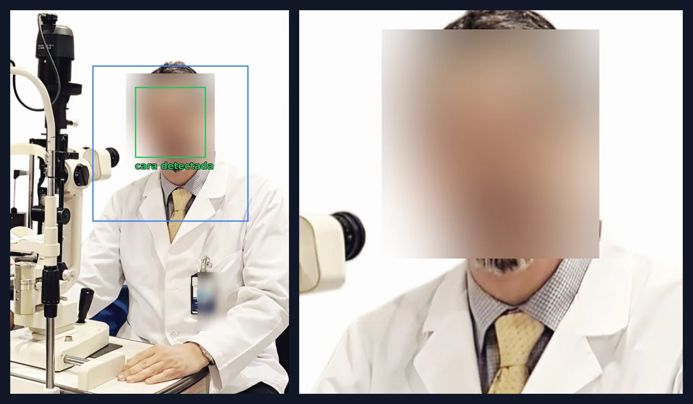
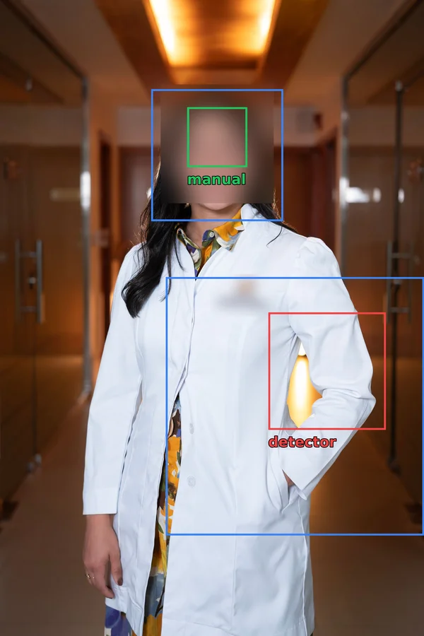
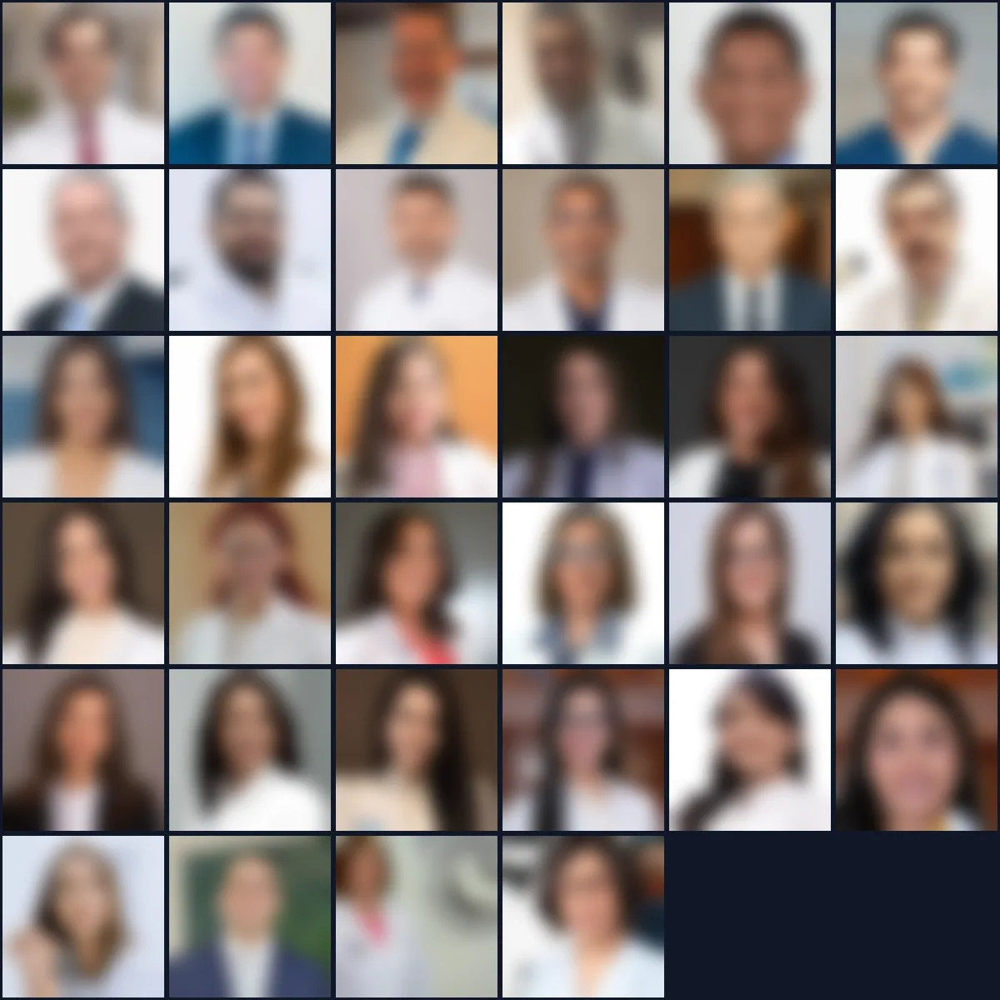

Hace poco me tocó una de esas tareas que parecen sencillas hasta que abres la carpeta. Estoy montando un directorio médico para un cliente y me llegó un WeTransfer con 34 fotos de los doctores. El requisito era claro: todas en **400x400** y con la cara bien encuadrada.

El problema es que no había dos fotos iguales. Algunas eran retratos de estudio de 1980x2970, otras capturas de 232x320, unas horizontales, otras verticales, PNG, JPEG, `.JPG` en mayúsculas… Y en muchas la persona salía de cuerpo entero, así que un recorte al centro les cortaba la cabeza o dejaba solo la bata.

Hacerlo a mano en un editor significaba 34 recortes, uno por uno. Así que preferí automatizarlo.

## La idea

El plan tiene tres pasos:

1. Detectar dónde está la cara en cada foto.
2. Calcular un cuadrado alrededor de esa cara que incluya un poco de pelo arriba y los hombros abajo, como una foto de perfil.
3. Recortar ese cuadrado y redimensionarlo a 400x400.

Y una regla extra: si alguna foto ya venía en 400x400, se deja tal cual.

## Detectar la cara con Haar cascade

Para la detección usé un **Haar cascade** de OpenCV. Es un método clásico (Viola-Jones, de 2001), nada de redes neuronales. Funciona más o menos así:

- La imagen se pasa a escala de grises y se ecualiza el histograma para mejorar el contraste.
- Una ventana recorre la imagen a distintos tamaños buscando patrones de claro y oscuro típicos de una cara: los ojos suelen ser más oscuros que la frente, el puente de la nariz más claro que los lados, etc.
- Cada ventana pasa por una cascada de filtros. Si falla uno, se descarta enseguida. Por eso es tan rápido.
- Al final se agrupan las detecciones que se solapan y me quedo con la cara más grande, que normalmente es la persona protagonista de la foto.

En código queda así:

```python
det = cv2.CascadeClassifier("haarcascade_frontalface_default.xml")

def find_face(gray):
    g = cv2.equalizeHist(gray)
    for mn in (6, 4, 3):
        faces = det.detectMultiScale(g, scaleFactor=1.05, minNeighbors=mn, minSize=(40, 40))
        if len(faces):
            return max(faces, key=lambda f: f[2] * f[3])
    return None
```

El truco del bucle con `minNeighbors` es empezar exigente (6) y relajarlo (4, luego 3) solo si no encuentra nada. Así evito falsos positivos en las fotos fáciles sin rendirme en las difíciles.

Un detalle que me ahorró un dolor de cabeza: la versión 5 de `opencv-python-headless` ya no trae los archivos `.xml` de los cascades dentro del paquete, así que hay que descargar `haarcascade_frontalface_default.xml` directamente del repositorio de OpenCV.

## Calcular el encuadre

Con la caja de la cara (`x, y, ancho, alto`) calculo el cuadrado del recorte:

```python
side = min(max(fh * 1.9, fw * 2.2), w, h)
cx = fx + fw / 2
left = min(max(cx - side / 2, 0), w - side)
top = min(max(fy - 0.3 * fh, 0), h - side)
```

- El lado del cuadrado es unas **1.9 veces el alto de la cara**, así la cara ocupa poco más de la mitad de la foto.
- Horizontalmente, la cara queda centrada.
- Verticalmente, el cuadrado empieza un **30 % de la altura de la cara por encima** de ella, para que no se corte el pelo y queden los hombros abajo.
- Si el cuadrado se sale de la imagen, lo empujo hacia dentro en lugar de rellenar con negro.

Aquí se ve el resultado en una de las fotos (las caras y los nombres están difuminados por privacidad). En verde está la cara que encontró el detector, en azul el cuadrado que se recorta, y a la derecha la foto final de 400x400:



Antes de recortar también hago dos cosas que parecen menores pero importan:

- `ImageOps.exif_transpose()` para respetar la orientación EXIF. Si no, las fotos de celular salen de lado.
- Convertir los PNG con transparencia sobre fondo blanco antes de guardarlos como JPEG.

## Cuando el detector falla

De las 34 fotos, el detector acertó en 31. En las otras tres pasó esto:

- En dos fotos no encontró ninguna cara. Eran fotos de cuerpo entero, con la cara pequeña respecto al total de la imagen y con iluminación de estudio.
- En la tercera encontró una "cara" donde no la había: un trozo de la bata con una luz detrás.



Esa es la gran limitación de los Haar cascades: funcionan bien con caras frontales, derechas y de buen tamaño, pero se pierden con ángulos, sombras o caras pequeñas.

Para estas tres no me compliqué: marqué la caja de la cara a mano y las dejé fijas en el script:

```python
MANUAL = {
    "doctora-07.png": (404, 265, 223, 223),
    "doctora-19.jpg": (874, 500, 280, 280),
    "doctor-05.png": (785, 280, 320, 320),
}
```

Si el nombre del archivo está en `MANUAL`, el script usa esa caja; si no, usa el detector. Para tres fotos de 34 no valía la pena meterle un modelo de redes neuronales. Si fueran 300, seguramente cambiaría a algo como YuNet o MediaPipe, que manejan mucho mejor los ángulos y la luz.

## Revisar el resultado de un vistazo

Lo que más me sirvió fue generar una **hoja de contactos**: una sola imagen con todas las fotos recortadas en miniatura. Así revisé las 34 en segundos y vi enseguida cuáles habían salido mal.



Incluso difuminadas se nota lo importante: todas las caras quedan a una altura y un tamaño parecidos, que es justo lo que necesita un directorio para verse ordenado.

## El script completo

Lo dejé en un solo archivo. Se ejecuta en la carpeta de las fotos y escribe los resultados en una subcarpeta `400x400`:

```python
import os
import sys

import cv2
import numpy as np
from PIL import Image, ImageOps

HERE = os.path.dirname(os.path.abspath(__file__))
SRC = sys.argv[1] if len(sys.argv) > 1 else HERE
DST = sys.argv[2] if len(sys.argv) > 2 else os.path.join(HERE, "400x400")
CASC = os.path.join(HERE, "haarcascade_frontalface_default.xml")

# Caras que el detector no resolvió bien: (x, y, ancho, alto) en píxeles originales
MANUAL = {}

os.makedirs(DST, exist_ok=True)
det = cv2.CascadeClassifier(CASC)


def find_face(gray):
    g = cv2.equalizeHist(gray)
    for mn in (6, 4, 3):
        faces = det.detectMultiScale(g, scaleFactor=1.05, minNeighbors=mn, minSize=(40, 40))
        if len(faces):
            return max(faces, key=lambda f: f[2] * f[3])
    return None


def load_rgb(path):
    img = ImageOps.exif_transpose(Image.open(path))
    if img.mode == "RGBA" or (img.mode == "P" and "transparency" in img.info):
        img = img.convert("RGBA")
        bg = Image.new("RGB", img.size, (255, 255, 255))
        bg.paste(img, mask=img.split()[3])
        return bg
    return img.convert("RGB")


def save_crop(img, face, out_path):
    w, h = img.size
    fx, fy, fw, fh = face
    side = min(max(fh * 1.9, fw * 2.2), w, h)
    cx = fx + fw / 2
    left = min(max(cx - side / 2, 0), w - side)
    top = min(max(fy - 0.3 * fh, 0), h - side)
    box = tuple(int(round(v)) for v in (left, top, left + side, top + side))
    img.crop(box).resize((400, 400), Image.LANCZOS).save(out_path, quality=92, optimize=True)
    return box


for name in sorted(os.listdir(SRC)):
    path = os.path.join(SRC, name)
    if not os.path.isfile(path) or not name.lower().endswith((".jpg", ".jpeg", ".png")):
        continue
    img = load_rgb(path)
    w, h = img.size
    out_path = os.path.join(DST, os.path.splitext(name)[0] + ".jpg")

    if (w, h) == (400, 400):
        img.save(out_path, quality=95)
        print(f"{name}: ya 400x400, sin cambios")
        continue

    if name in MANUAL:
        box = save_crop(img, MANUAL[name], out_path)
        print(f"{name}: cara manual, recorte {box}")
        continue

    gray = cv2.cvtColor(np.array(img), cv2.COLOR_RGB2GRAY)
    face = find_face(gray)
    if face is None:
        # sin cara detectada: recorte aproximado en la zona superior
        face = (w * 0.35, h * 0.2, w * 0.3, h * 0.35)
        note = "SIN CARA: recorte aproximado"
    else:
        note = "ok"
    box = save_crop(img, tuple(map(float, face)), out_path)
    print(f"{name}: {note}, recorte {box}")
```

Para usarlo:

```bash
pip install opencv-python-headless pillow numpy
curl -LO https://raw.githubusercontent.com/opencv/opencv/4.x/data/haarcascades/haarcascade_frontalface_default.xml
python3 crop_400.py
```

## Lo que me llevo

- **Un método clásico alcanza** para la mayoría de los casos. El Haar cascade resolvió el 90 % sin entrenar nada ni descargar modelos pesados.
- **El 10 % restante se resuelve a mano**, y está bien. No todo tiene que ser automático: tres cajas escritas a mano me costaron menos que cambiar de detector.
- **Revisar visualmente es obligatorio.** El detector no avisa cuando se equivoca; me lo dijo la hoja de contactos.
- **Una foto pequeña no se arregla.** Una de las fotos venía en 232x320 y al llevarla a 400x400 queda algo borrosa. Ahí la única solución real es pedir el original.

Lo que antes era una tarde de recortes se convirtió en un script que puedo reutilizar la próxima vez que me llegue un WeTransfer con fotos.
