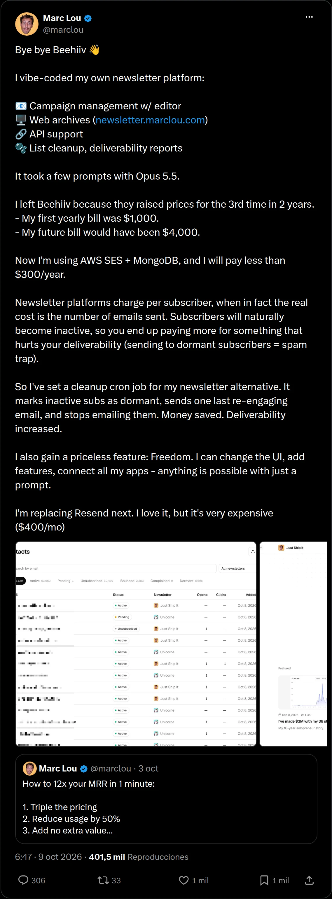
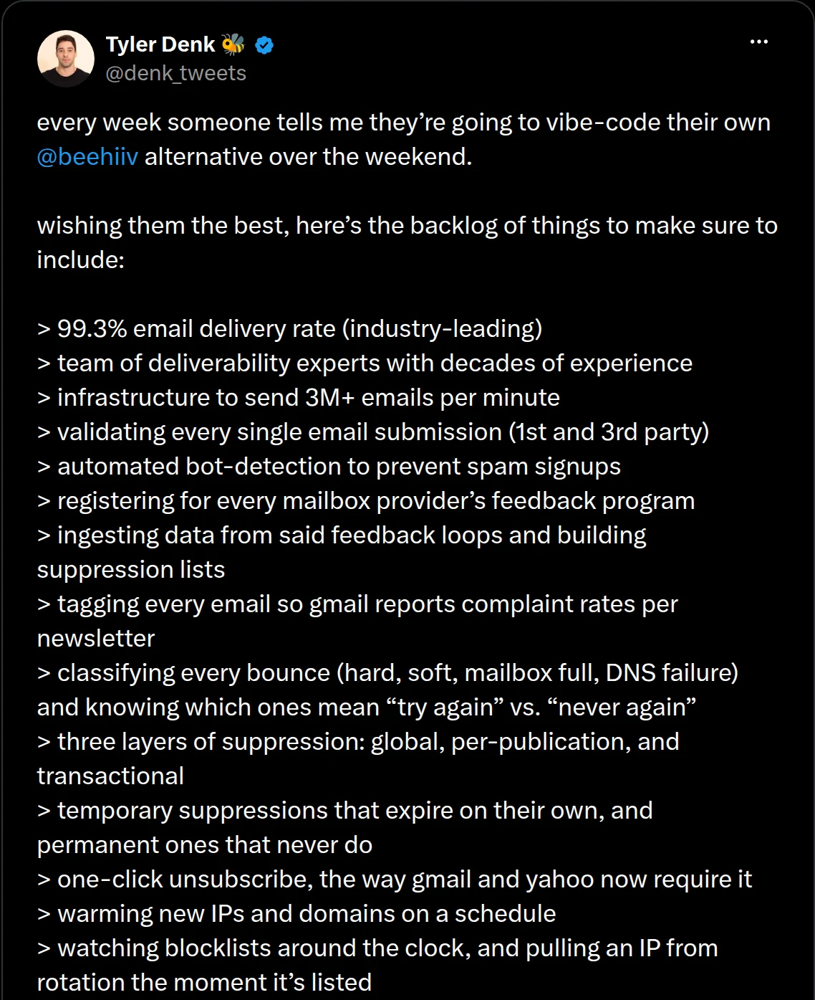
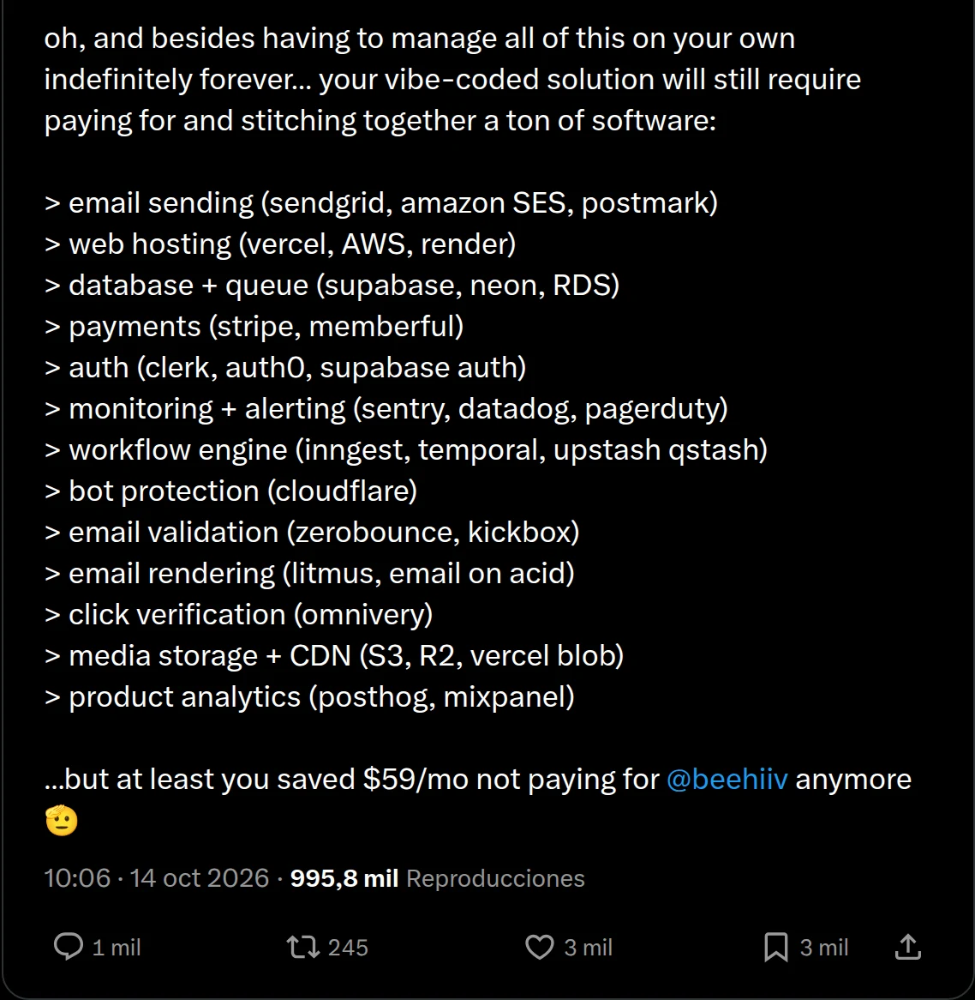
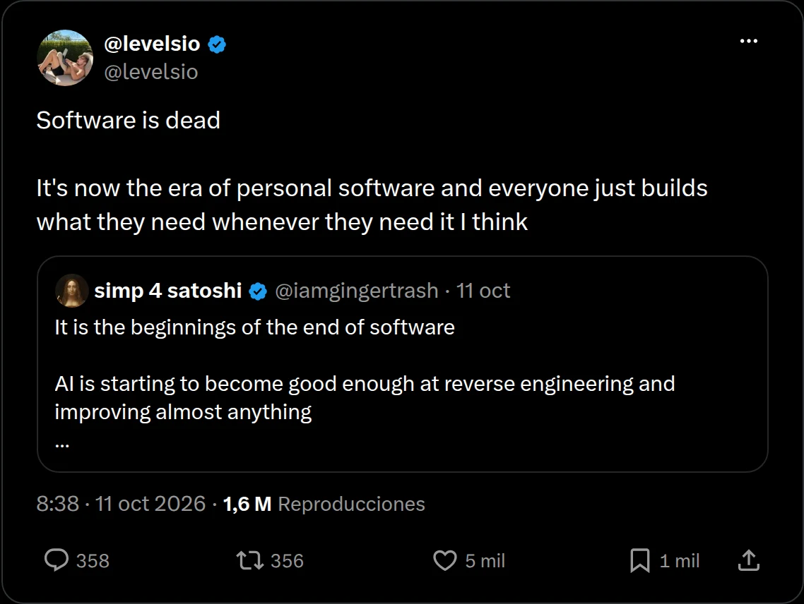
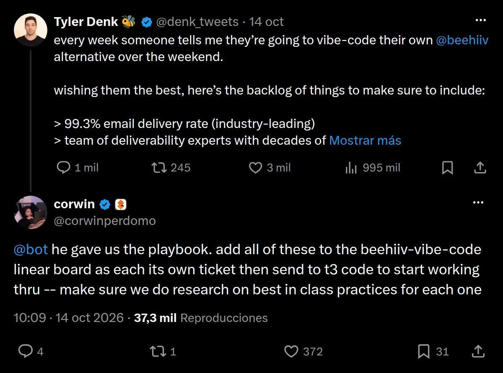

No sé si lo has notado, pero en los últimos meses algo cambió de verdad. Los modelos de IA, los frameworks y las herramientas de programación han avanzado tan rápido que hoy ya es posible hacer algo que hace un año parecía ciencia ficción: crear una aplicación completa de un solo tiro.

En inglés le dicen *one-shot*. Es como grabar una escena en una sola toma: escribes un prompt bien pensado y sales con una aplicación bastante completa. Hace seis meses o un año eso era casi imposible. Tenías que escribir un prompt larguísimo y lo que salía venía lleno de errores. Hoy no digo que esté al 100 %, pero con los modelos actuales, herramientas que ya pueden ver tu pantalla, tomar capturas y decidir a partir de ellas, y algunos conjuntos de *skills* que ayudan al agente a organizarse solo, un prompt bien definido te puede dar un resultado muy bueno.

Y eso me lleva a una discusión que se armó en internet y que creo que dice mucho de hacia dónde vamos.

## "Adiós, Beehiiv"

Si no conoces a Marc Lou, es un creador indie bastante conocido. Lleva años lanzando productos, desde antes del boom de la IA, y vive de sus proyectos paralelos.

Hace poco [publicó un tuit](https://x.com/marclou/status/2108509543810605218) que hizo mucho ruido: se despedía de Beehiiv, la plataforma para crear newsletters y comunidades por correo (la de la abejita). Contó que programó su propia plataforma de newsletter con unos cuantos prompts a Opus 5.5: gestión de campañas, editor de correos, archivo web, API, limpieza de listas y reportes de entregabilidad.

¿La razón? Beehiiv subió sus precios por tercera vez en dos años. Su primera factura anual fue de unos 1,000 dólares y, con los aumentos, iba camino a los 4,000. Ahora, montado sobre AWS y MongoDB, dice que va a pagar menos de 300 dólares al año.

Su crítica principal es al modelo de cobro: estas plataformas cobran por suscriptor, cuando el costo real está en la cantidad de correos que envías. Los suscriptores se van volviendo inactivos con el tiempo y tú sigues pagando por ellos, aunque encima te dañen la entregabilidad. Así que montó una tarea automática para limpiar su lista y marcar a los inactivos. Y, según él, ganó algo que no tiene precio: libertad para cambiar lo que quiera.

El tuit pasó de las 400,000 visualizaciones.

## Mi opinión sobre el tema de los precios

Aquí voy a defender un poco a los creadores pequeños, porque creo que el cobro por suscriptor nos favorece cuando estamos empezando.

Piensa en alguien como Dan Koe, con cientos de miles de suscriptores. Seguro paga una fortuna al mes. Pero también ya creció, tiene dinero y tiene comunidad, así que me parece justo que pague más.

Si el modelo cambiara a cobrar por correo enviado, los perjudicados seríamos los pequeños, los que tenemos una comunidad de 1,000 o 2,000 personas. Cuando estás creciendo quieres escribir seguido: una, dos o tres veces por semana. Si te cobran cada envío, lo que hacen es limitar tu interacción con tu gente justo cuando más la necesitas.

## La respuesta del CEO de Beehiiv

El ruido fue tanto que Tyler Denk, cofundador y CEO de Beehiiv, [salió a responder](https://x.com/denk_tweets/status/2110371582153748942). Dijo, con bastante sarcasmo, que cada semana alguien le cuenta que va a construir su propio Beehiiv en un fin de semana, que les desea suerte, y les dejó "la lista de pendientes" que tendrían que incluir.

Y la lista no se acaba nunca. De verdad, creo que es el tuit más largo que he visto en mi vida: más de 350 puntos. Me lo imagino a las 3 de la mañana, harto de leer que su producto se copia en una tarde, pidiéndole a una IA que le saque miles de funcionalidades para que el tuit no termine jamás. Y al final remata con algo como: "pero al menos te ahorraste 59 dólares al mes".

## Dónde creo que Tyler tiene razón… y dónde no

Veo dos ángulos.

Primero, lo de los 59 dólares depende mucho de la escala. Si ya tienes una comunidad grande, no pagas 59: pagas 100, 200 o 300 al mes.

Segundo, y para mí lo más importante: Tyler lo está viendo desde la perspectiva de alguien que quiere clonar Beehiiv para venderlo como competencia. En ese caso le doy la razón. Muchas cosas de su lista son difíciles de replicar porque no son solo código, son conocimiento del negocio. Por ejemplo, descubrir otras newsletters con las que hacer alianzas. Eso es estrategia, y ahí una IA te puede dar ideas, pero no te arma el negocio.

Pero hay un ángulo del que casi nadie está hablando: **yo no necesito clonar Beehiiv para competir con Beehiiv.** Me basta con construir mi propia versión para resolver mi problema.

Imagina que te digo: "únete a mi newsletter para recibir cada semana las novedades de IA", y el enlace te lleva a una plataforma que hice yo, una especie de Beehiiv sencillo con exactamente las funciones que necesito como creador. Te registras, te llega tu correo semanal y listo. Solo pago el hosting. Claro, hay muchos detalles técnicos por debajo, pero supongamos que está bien hecho y bien pensado.

¿Para qué voy a pagar 60, 100 o 200 dólares al mes por un servicio que puedo construir en una tarde o un fin de semana? En ese escenario, esa montaña de funcionalidades se reduce a la mitad o mucho menos, porque yo solo necesito las mías.

## El software se está volviendo un commodity

Aquí es donde entra la idea de que el software se está convirtiendo en algo tan común como grabar un video. Pieter Levels lo resumió en [otro tuit viral](https://x.com/levelsio/status/2109262337500705094): el software está muerto y esta es la era del software personal, donde cada quien construye lo que necesita cuando lo necesita.

Comparto esa visión. ¿Exagerada? No lo creo, porque lo he vivido.

No todo el mundo se va a sentar a crear sus propias herramientas. Pero la gente que quiere crear, probar cosas y construir comunidad probablemente va a terminar haciendo sus propias herramientas a menor costo. No voy a querer seguir pagando 50 dólares por un servicio aquí, 10 por otro allá y 5 por otro más, si puedo copiar uno en una tarde, otro al día siguiente y otro el siguiente. En uno o dos meses tendría mi propia suite, personalizada, con las funciones que me sirven y que disfruto usar.

Repito: hoy todavía no es tan sencillo. Todavía gastas muchos tokens y muchas horas. Pero te invito a mirar un poco más allá. Si hoy, en octubre de 2026, ya puedo crear aplicaciones casi sin conocimientos técnicos, sin siquiera revisar el código, ¿cómo será esto en octubre de 2027? Y no hablo de años: creo que esto se va a notar en los próximos meses.

## Plantillas: el nuevo open source

Una idea que me encanta es la de las plantillas. Debería haber una plantilla para todo: si quieres tu propio sistema de correos, que ya exista una base con toda la infraestructura, y que los agentes partan de ahí en vez de construir todo desde cero cada vez.

Ya tenemos modelos capaces de hacer ingeniería inversa de un sistema completo. A partir de eso se puede publicar una plantilla abierta. Llamémosle el nuevo open source: ya no tiene mucho sentido liberar el código de una app que cualquiera puede generar de un tiro, pero sí liberar la plantilla para que cada quien arme la suya.

¿Quieres tu propio Notion? Vas a GitHub, encuentras una buena plantilla, creas tu versión y de ahí le agregas lo que quieras. No lo veo nada lejano.

Y eso cambia las reglas para quien vende software: sus propios clientes pueden hacerse su copia.

## Los memes no se hicieron esperar

Como era de esperarse, internet se burló del tuit de Tyler. Mucha gente le respondió que, sin querer, había escrito el prompt completo. Con esa lista tan detallada, solo tienes que pegársela a tu IA y decirle algo como "implementa cada punto, sin errores". Una tarde libre y un refresco, y listo.

Hubo quien lo dijo literal: a los tres minutos ya le estaba pidiendo a su bot que convirtiera cada punto de la lista en un ticket y lo mandara a un agente a programarlo.

Es irónico: quiso demostrar lo difícil que es copiar su producto y terminó entregando el backlog perfecto para hacerlo.

## Entonces, ¿está muerto el software?

Para mí, el software como lo conocíamos murió o está por morir. Va a quedar un nicho, eso sí.

Siempre va a haber gente que prefiera pagar. Personas con vidas ya bastante complicadas que no quieren estresarse creando sus propias herramientas, o que usan la IA para hacer fotos de su perrito y mandarlas al grupo de WhatsApp de la familia. Y está perfecto, no lo critico. Esos clientes van a seguir existiendo.

Pero creo que cada vez habrá más gente creando sus propias soluciones y menos gente pagando por las de otros.

Ahora te pregunto a ti: ¿crees que el software está muerto, o esto es solo una transición y todo va a volver a la normalidad? ¿El software todavía tiene valor para ti? Déjame tu opinión en los comentarios.
