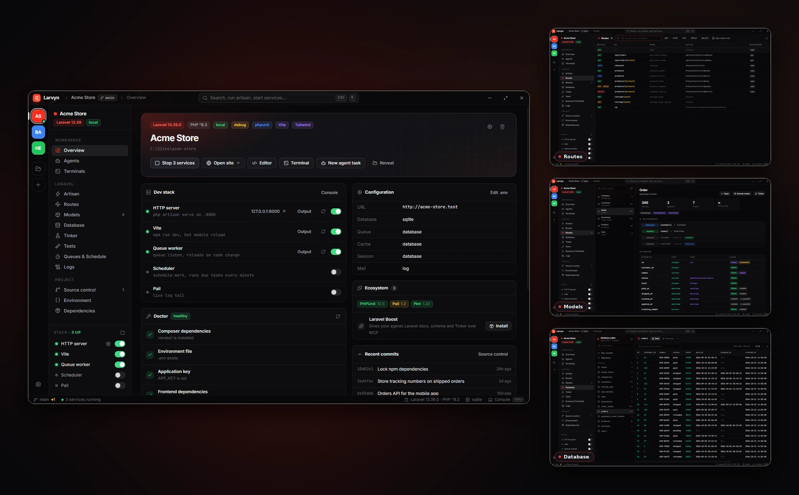

Voy a ser honesto desde el principio: Larvyn no nació de un plan. No hubo una noche de inspiración en la que me senté y dije "voy a construir una app de escritorio para Laravel". Si alguien me lo hubiera propuesto hace cuatro años, le habría dicho que eso era demasiado para mí.

Lo que sí hubo fue una costumbre. Una manía, casi. Cada vez que algo me molestaba lo suficiente, terminaba escribiendo una herramienta para no tener que volver a hacerlo. La mayoría de esas herramientas las usó muy poca gente. Algunas solo las usé yo. Pero cada una me dejó algo, y hoy, mirando hacia atrás, me doy cuenta de que todas me estaban preparando para esto.

Esta es esa historia, en orden, y contada como la viví.

## Empecé por flojo (y no me arrepiento)

En abril de 2022 yo estaba haciendo proyectos en React, y cada uno empezaba con el mismo ritual aburrido: instalar ESLint, instalar Prettier, pelearme con las reglas que chocaban entre sí, crear los mismos archivos de configuración de siempre. Era como tener que armar la mesa cada vez que querías comer.

Así que hice [nohands](https://www.npmjs.com/package/nohands). Un comando, `npx nohands`, y todo quedaba listo. Le puse ese nombre porque la idea era justamente esa: configurar sin manos.

Era un proyecto chiquito, pero en cinco días saqué siete versiones, porque cada vez que lo usaba encontraba algo que mejorar. Hoy tiene unas 340 descargas en total. No cambió el mundo, pero me cambió a mí: descubrí que podía convertir una molestia en algo que funcionaba solo.

Seis meses después me pasó lo mismo con Tailwind, y nació [add-tailwindcss](https://www.npmjs.com/package/add-tailwindcss): otro comando, `npx add-tailwindcss`, que detectaba si estabas en Laravel, Vite, Next.js o Create React App y lo configuraba por ti. Diez versiones en tres días. Ahí ya no era casualidad, era un patrón.

## La extensión más simple del mundo

En mayo de 2023 di mi primer paso dentro del editor con [HTML WrapMagic](https://marketplace.visualstudio.com/items?itemName=IvanMercedes.html-wrapmagic). Hace una sola cosa: seleccionas un texto, presionas `Ctrl+Shift+Z` y lo envuelves en la etiqueta HTML que quieras.

Es probablemente la extensión más simple que existe. Y aun así, hoy tiene más de 750 instalaciones. Eso me enseñó algo importante: no tiene que ser complicado para ser útil. A veces lo que la gente necesita es que le quites un fastidio pequeño.

## El proyecto que no solté

En noviembre de 2023 volví a npm con [picslim](https://www.npmjs.com/package/picslim). El problema era otro clásico: imágenes pesadas. Antes de subir un sitio tenía que comprimir fotos una por una o pasarlas por alguna página que me pedía subirlas y volver a descargarlas. Con picslim apuntas a una carpeta y optimiza todo de una vez, en JPEG, PNG, WebP o AVIF.

Lo que hace especial a picslim en esta historia no es lo que hace, sino que no lo abandoné. Todo lo anterior lo publicaba, lo usaba un tiempo y seguía con otra cosa. A picslim le seguí dando cariño durante más de dos años: le agregué WebP, AVIF, procesamiento en paralelo usando todos los núcleos del procesador y búsqueda en subcarpetas, hasta la versión 2.1.0 en febrero de 2026. Solo desde abril de 2025 lleva más de 750 descargas.

Ahí aprendí que publicar algo es apenas el principio. Mantenerlo vivo es otra habilidad, y una que iba a necesitar mucho más adelante.

### Una mención especial

picslim también me trajo algo que no esperaba: mi primer colaborador.

El mismo día que lo publiqué, [Elminson De Oleo Baez](https://github.com/elminson) lo vio y decidió colaborar. Abrió el primer pull request que tuvo el proyecto, uno para que picslim procesara las imágenes según el archivo de configuración, que es la base del `config.json` que sigue usando hoy. Lo mergeé ese mismo día.

Puede parecer poca cosa, pero cuando llevas tiempo publicando herramientas que nadie comenta, que alguien que no conoces se detenga, lea tu código y decida mejorarlo cambia algo en ti. Te hace sentir que lo que haces sí le importa a alguien más. Gracias, Elminson, por ser el primero.

## Los años en los que todo se mezcló

Lo que vino después no fue una línea recta. Entre 2023 y 2025 pasé mucho tiempo construyendo, rompiendo y reconstruyendo el producto que terminaría siendo [Zubmit](/blog/diario-de-un-developer-el-largo-y-caotico-camino-hasta-crear-zubmit), y en 2025 me puse el [reto de crear 8 apps antes de terminar el año](/blog/mi-aventura-epica-2025), como si fuera la Liga Pokémon. Todo eso mientras trabajaba en mi empleo.

En medio de ese caos fue cuando Laravel se convirtió en mi casa. Y cuando pasas suficiente tiempo en una casa, empiezas a notar todas las cosas que quieres arreglar.

## Las extensiones que nacieron de la terminal

La primera fue en mayo de 2025. Llevaba años escribiendo `php artisan route:list` y leyendo una tabla gigante en la terminal que nunca cabía en la pantalla. Un día me cansé e hice [Laravel Route Preview](/blog/laravel-route-preview): todas las rutas en una tabla bonita dentro de VS Code, con filtros y un clic para abrir el controlador.

Tres semanas después ya estaba con la siguiente, [Laravel Models Explorer](https://marketplace.visualstudio.com/items?itemName=IvanMercedes.laravel-models-explorer), porque me di cuenta de que con los modelos me pasaba lo mismo: abría el archivo solo para recordar qué campos eran `fillable` o con quién se relacionaba. Y en enero de 2026 llegó [Laravel SQLite Viewer](https://github.com/ivanmercedes/laravel-sqlite-viewer), para ver y editar la base de datos sin salir del editor.

Aquí pasó algo que no esperaba. Hacer una extensión me daba ideas para la siguiente. Terminaba una y ya estaba viendo otro problema. Era como si el cerebro, una vez que aprende a buscar fricciones, ya no pudiera dejar de verlas.

## Cuando empecé a construir para otros

Hasta ese momento todo lo que hacía era para mi propio entorno. En noviembre de 2025 crucé una línea distinta con [Laravel FormInertia](https://github.com/ivanmercedes/laravel-forminertia), un form builder para el Inertia Starter Kit de Laravel. Ya no era una herramienta para mí: era un paquete que otros developers iban a meter dentro de sus aplicaciones.

Eso me obligó a pensar diferente. Ya no bastaba con que algo me funcionara. Tenía que funcionarle a alguien que nunca había visto mi código, con nombres claros, con documentación, con decisiones que tuvieran sentido desde afuera.

Y en julio de 2026 me fui todavía más lejos con [FlexFields](https://packagist.org/packages/ivanmercedes/flex-fields), algo como Advanced Custom Fields de WordPress, pero para Laravel y Filament. Empezó como una idea sencilla y terminó con 21 tipos de campo, historial de cambios, API, multi-tenancy y hasta herramientas para que agentes de IA trabajen con el contenido, pidiendo permiso antes de borrar algo.

Si me hubieras dicho en 2022, mientras configuraba ESLint, que iba a terminar construyendo algo así, no te lo habría creído.

## Crear me hizo más creativo

Esto es lo que más quiero que te lleves de este post.

Durante mucho tiempo pensé que la creatividad era algo que llegaba sola, una idea brillante que aparece cuando menos la esperas. No me pasó así. A mí la creatividad me llegó haciendo. Cada proyecto terminado, por pequeño que fuera, me dejaba viendo el siguiente problema, y el siguiente siempre era un poco más grande.

De un comando para configurar ESLint pasé a una extensión, y de ahí a un proyecto que mantuve durante años. De una extensión a tres. De herramientas para mí a paquetes para otros. De paquetes a un ACF completo para Filament. Ninguno de esos saltos lo planeé. Simplemente, cada cosa que construía me hacía capaz de imaginar la siguiente.

## Y entonces, Larvyn

A inicios de octubre de 2026 me senté frente a un problema que ya no era una tarea, eran todas. Mi día con Laravel era saltar entre la terminal, el editor, un cliente de base de datos, el navegador, los logs, los tests y, ahora, varios agentes de IA trabajando al mismo tiempo en el mismo código. Todo separado. Todo con su propia ventana.

Y por primera vez sentí que tenía todo lo necesario para atacarlo de una sola vez.

Los comandos de nohands me habían enseñado a quitar pasos, y picslim a no soltar un proyecto. Las extensiones me habían enseñado a leer un proyecto Laravel por dentro. FormInertia me había enseñado a construir para otros. FlexFields me había enseñado a sostener algo grande y a trabajar con agentes con una persona revisando. Larvyn necesitaba todo eso a la vez.



Para finales de octubre ya tenía algo que funcionaba: una app de escritorio con terminales que nunca se cierran, el dev stack con un clic, agentes de IA en paralelo, cada uno en su propia rama, y las vistas de rutas, modelos y base de datos que antes vivían en tres extensiones separadas. La primera beta pública salió a inicios de noviembre.

Hay un detalle que me hace sonreír: Larvyn se instala con un solo comando, igual que nohands hace cuatro años.

```bash
curl -fsSL https://raw.githubusercontent.com/larvyn/releases/main/install.sh | sh
```

En Windows, desde PowerShell:

```powershell
irm https://raw.githubusercontent.com/larvyn/releases/main/install.ps1 | iex
```

Es como si todo hubiera dado una vuelta completa.

## Si estás donde yo estaba

Si estás haciendo herramientas pequeñas que casi nadie usa, no pares. No las midas por las descargas. Mídelas por lo que aprendiste haciéndolas y por la siguiente idea que te dejaron.

Yo no sabía que nohands me iba a llevar a Larvyn. Nadie lo sabe al principio. Solo sé que si no hubiera publicado ese primer paquete chiquito, nada de lo que vino después existiría.

Larvyn está en beta. Si trabajas con Laravel, pruébala, rómpela y cuéntame qué le falta. Hay un botón de **Report a bug** arriba en la ventana justo para eso. Al fin y al cabo, así empezó todo: con algo que me faltaba.
