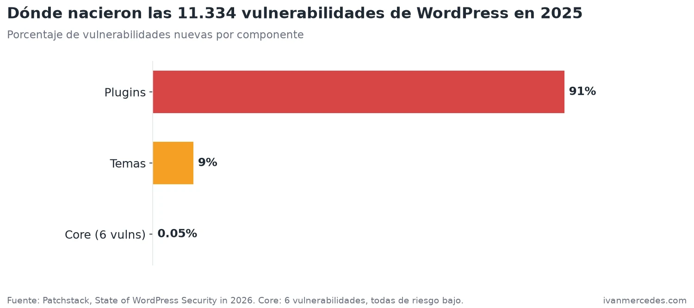
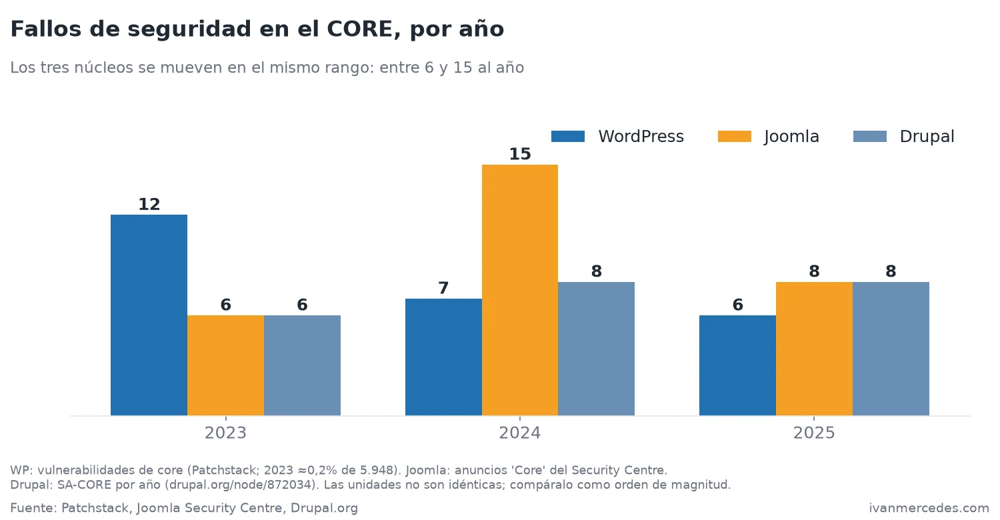
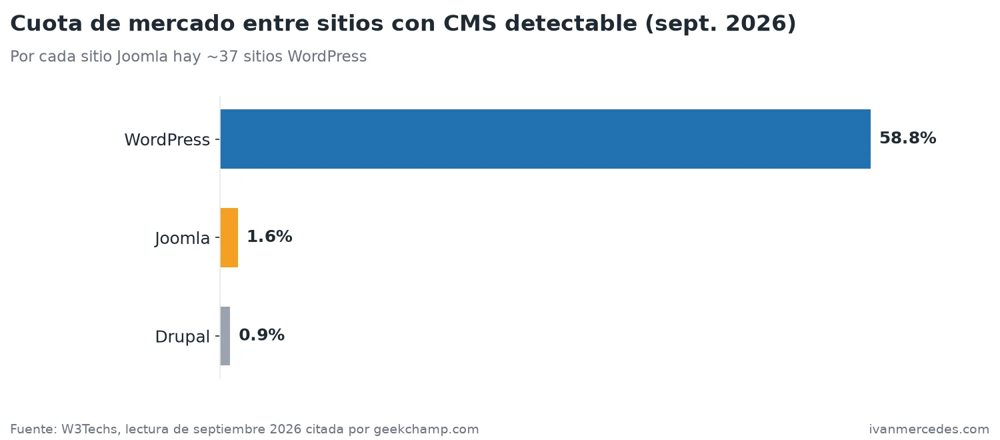
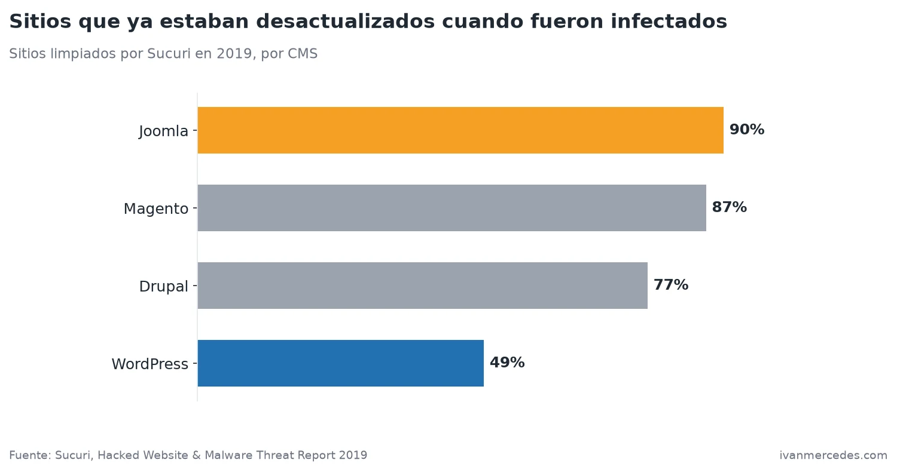
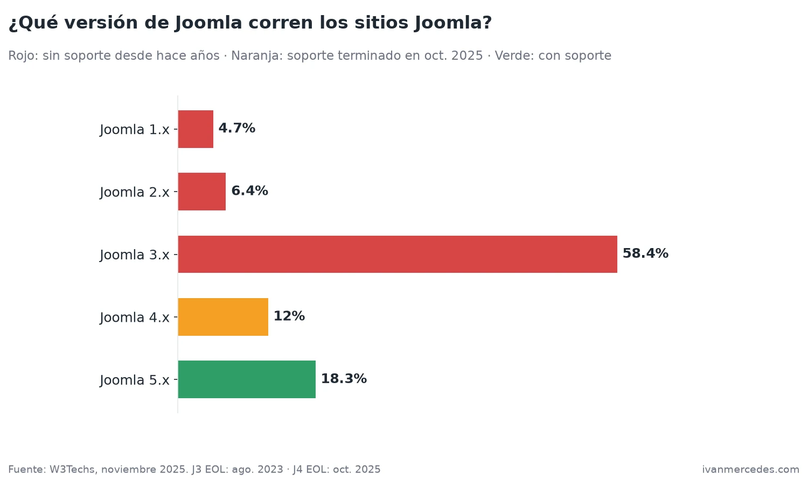
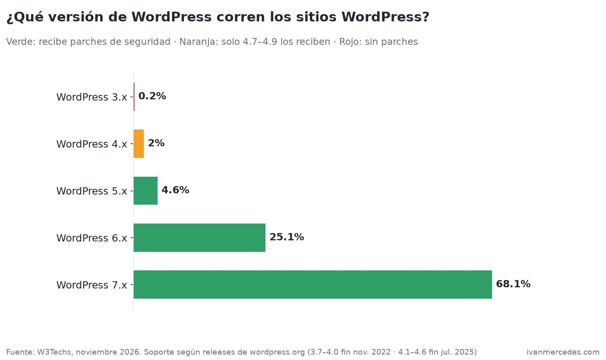
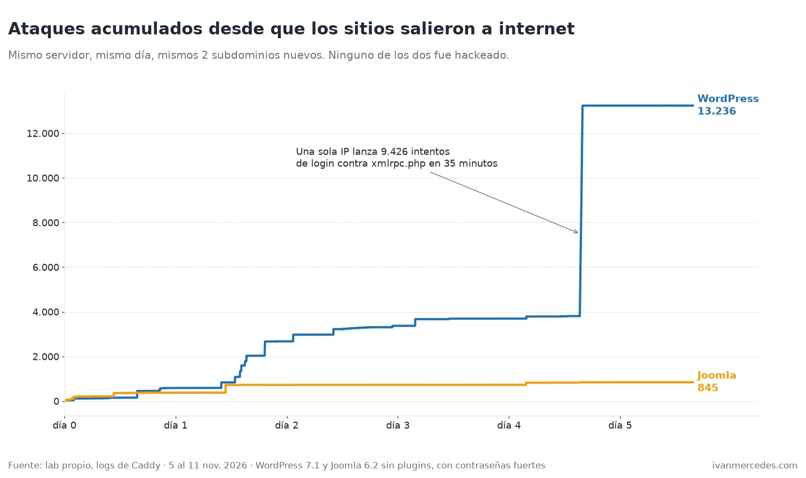
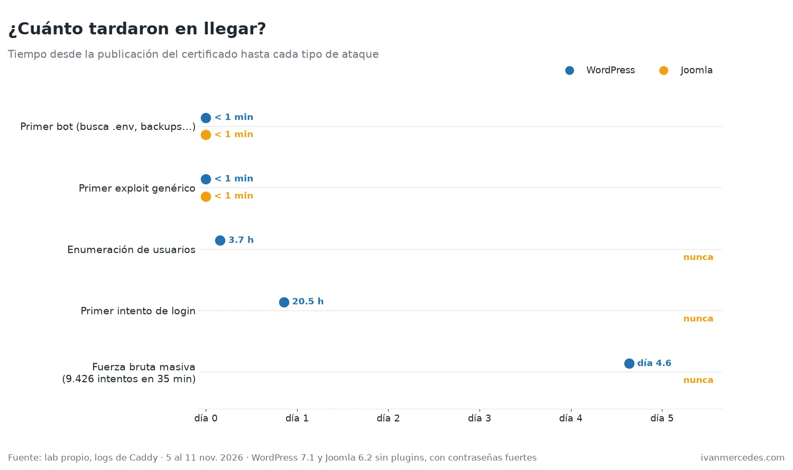
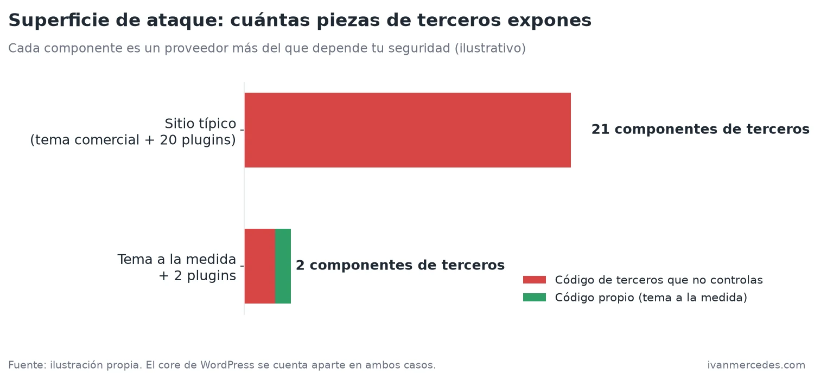

Cada cierto tiempo alguien me dice "WordPress es inseguro". Y cada vez respondo lo mismo: **WordPress no es inseguro. Lo inseguro es lo que la gente le instala encima.**

En este post quiero sostener esa frase con datos, no con opinión. Vamos a ver de dónde salen realmente las vulnerabilidades, por qué los atacantes eligen WordPress y no Joomla, qué tiene que ver la cuota de mercado con todo esto, y por qué mi regla para proyectos de clientes es **tema a la medida y máximo dos plugins**.

Y de paso vamos a hablar de algo que he visto más de una vez y que parece contradecir todo: **un Joomla de desarrollo con usuario `admin` y contraseña `admin` que pasa meses, a veces años, sin que nadie lo ataque**. Spoiler: no es que Joomla sea más seguro. Es economía. Y para comprobarlo, expuse un WordPress y un Joomla recién instalados durante 6 días: **el WordPress recibió 10.329 intentos de login y el Joomla, ninguno**.

## Primero, los datos: ¿dónde nacen las vulnerabilidades?

Patchstack, que mantiene una de las bases de datos de vulnerabilidades de WordPress más grandes, publicó su informe *State of WordPress Security in 2026* con los datos de todo 2025. Los números son brutales:

- **11.334 vulnerabilidades nuevas** en el ecosistema en un año, un 42 % más que en 2024.
- **91 % en plugins**, **9 % en temas**.
- En el **core de WordPress: 6**. Seis. Y todas de riesgo bajo.
- El **46 %** no tenía parche disponible del desarrollador en el momento de hacerse públicas.



Léelo otra vez: **seis vulnerabilidades en el core contra más de diez mil en plugins**. El core de WordPress tiene un equipo de seguridad dedicado, revisión de código, auto-updates de seguridad activados por defecto desde la versión 3.7 y años de auditorías encima. Un plugin cualquiera del directorio puede estar escrito por una sola persona un fin de semana y llevar tres años sin actualizarse.

Cuando alguien dice "hackearon mi WordPress", lo que casi siempre pasó es "hackearon un plugin que yo instalé en mi WordPress".

## ¿Y los demás CMS? El core está igual de blindado en todos

Para que no parezca que defiendo a WordPress por cariño, fui a buscar los mismos números de Joomla y Drupal en sus fuentes oficiales: el [Joomla Security Centre](https://developer.joomla.org/security-centre.html), donde cada anuncio viene etiquetado como *Core*, y la [tabla de avisos por año de Drupal.org](https://www.drupal.org/node/872034), que separa core de módulos contribuidos.



| Año | WordPress core | Joomla core | Drupal core |
|---|---|---|---|
| 2023 | ~12 | 6 | 6 |
| 2024 | 7 | 15 | 8 |
| 2025 | 6 | 8 | 8 |

Los tres núcleos se mueven en el **mismo rango: entre 6 y 15 fallos al año**. Ninguno es un colador y ninguno es invulnerable. Y la mayoría son de severidad baja o moderada: de los 8 anuncios de core de Joomla en 2025, 5 son *Moderate* y 3 son *Low*.

Un matiz honesto: las unidades no son idénticas. Patchstack cuenta vulnerabilidades, Joomla cuenta anuncios y un aviso de Drupal puede agrupar más de un fallo. Por eso hay que leerlo como **orden de magnitud**, no como un ranking. Y el orden de magnitud dice lo mismo en los tres casos: un puñado al año.

Donde sí se separan es en el **ecosistema**. Drupal lo muestra mejor que nadie porque publica las dos columnas en la misma tabla:

| Año | Drupal core | Drupal módulos contribuidos |
|---|---|---|
| 2023 | 6 | 55 |
| 2024 | 8 | 76 |
| 2025 | 8 | **113** |

En 2025, por cada aviso de core hubo **más de 14 de módulos de terceros**. En WordPress la proporción es mucho más extrema (6 frente a más de 11.000) porque su ecosistema es muchísimo más grande. El patrón es el mismo en todos lados: **el núcleo lo mantiene un equipo de seguridad dedicado; las extensiones, cualquiera.**

### Todos los cores han tenido su día malo

Que el core sea sólido no significa que nunca falle. Cada uno ha tenido al menos un fallo grave que se explotó en masa:

- **WordPress 4.7.0 y 4.7.1 (2017)**: un fallo en la API REST permitía modificar el contenido de cualquier entrada sin autenticarse. Se usó para desfigurar cientos de miles de páginas en pocos días, aunque las actualizaciones automáticas ya habían parcheado a muchos sitios.
- **Drupal, "Drupalgeddon 2" (2018, CVE-2018-7600)**: ejecución remota de código sin autenticación en el core. Fue explotado masivamente pocas horas después de publicarse el exploit.
- **Joomla 4.0.0 a 4.2.7 (2023, CVE-2023-23752)**: fuga de la configuración, incluidas las credenciales de la base de datos, sin autenticar. Hoy está en el catálogo KEV de CISA (lo vemos más abajo).

La diferencia es que estos fallos de core son **raros y se parchean rápido**, porque hay un equipo de seguridad detrás y, en el caso de WordPress, actualizaciones automáticas de seguridad activadas por defecto. Los de plugins salen **cada semana** y, como vimos, casi la mitad llega sin parche.

La conclusión es la misma para cualquier CMS: **lo que decide tu seguridad no es qué core elegiste, sino cuánto código de terceros le pusiste encima y cuánto tiempo lo dejas sin actualizar.**

## La ventana entre el anuncio y el ataque: horas, no semanas

El otro dato del mismo informe que más me impactó: entre las vulnerabilidades más explotadas, la **mediana ponderada entre la publicación y la explotación masiva fue de unas 5 horas**.

Cinco horas. Es decir, si una vulnerabilidad sale a las 9 de la mañana en un plugin que tienes instalado, a la hora del almuerzo ya hay bots probándola contra internet entero. Tu ciclo de "lo actualizo el viernes" ya no sirve.

Y esto no es teórico. La campaña **Balada Injector**, documentada por Sucuri en 2023, lleva activa desde 2017 y ha infectado **más de un millón de sitios WordPress**. Su modus operandi es exactamente ese: integrar vulnerabilidades recién publicadas de plugins y temas, a veces en cuestión de horas, y lanzar oleadas masivas. Sucuri llegó a documentar un sitio atacado **311 veces con 11 variantes** distintas del malware.

Fíjate en el patrón: la campaña no apunta a WordPress. Apunta a **plugins y temas** de WordPress.

## Cuota de mercado: por qué WordPress es el blanco favorito

Aquí es donde la conversación se pone interesante. Según W3Techs, en 2026 WordPress mueve alrededor del **40 % de todos los sitios web** y cerca del **59 % de los sitios que usan un CMS detectable**. Joomla está en **1,6 %** y Drupal en **0,9 %**.



Por cada sitio Joomla hay unos **37 sitios WordPress**.

Ahora cruza eso con quién se hackea. El informe de Sucuri de 2018 encontró que **el 90 % de los sitios CMS infectados que limpiaron eran WordPress**, cuando su cuota de mercado entre CMS rondaba el 60 %. Joomla fue el 4,6 % y Magento el 4,3 %.

A primera vista parece que WordPress se hackea "más de la cuenta". Pero el mismo Sucuri aclara algo clave: sus datos **no indican que una plataforma sea más o menos segura que otra**, sino lo que les llega para limpiar. Y hay otro dato que le da la vuelta a la historia completa.

## El dato que nadie cuenta: Joomla se hackea por viejo

En su informe de 2019, Sucuri midió qué porcentaje de los sitios infectados **ya estaba desactualizado en el momento de la infección**:



- **Joomla: 90 %**
- Magento: 87 %
- Drupal: 77 %
- **WordPress: 49 %**

Traducido: cuando un Joomla cae, **casi siempre es porque lleva años sin tocarse**. Cuando un WordPress cae, la mitad de las veces estaba al día... pero tenía un plugin con un fallo recién publicado (o sin parche).

Son dos problemas distintos:

- **WordPress** tiene un problema de **ecosistema**: decenas de miles de plugins de calidad muy desigual, y un enorme incentivo para atacarlos.
- **Joomla** tiene un problema de **abandono**: instalaciones que se montaron una vez y nadie volvió a mantener.

## La decadencia de Joomla, en números

Joomla fue grande. Alrededor de 2014 rondaba el **9 % de los sitios con CMS**. Hoy está en **1,6 %**: una caída de más del 80 %. Mientras, Shopify y Wix se comieron buena parte del mercado de sitios "para no técnicos" que antes era terreno de Joomla.

Pero lo más preocupante no es la cuota, es **qué versión corren los que quedan**. Según W3Techs (noviembre 2025):



- **Joomla 3.x: 58,4 %**, y su soporte oficial terminó el **17 de agosto de 2023**.
- Joomla 1.x y 2.x: más del **11 %** sumados. Versiones de hace más de una década.
- Joomla 4.x: 12 %, y su soporte de seguridad terminó en **octubre de 2025**.
- Solo Joomla 5.x (18,3 %) seguía con soporte en esa fecha. Joomla 6 salió en octubre de 2025.

O sea: **alrededor de 8 de cada 10 sitios Joomla corren una versión que ya no recibe parches de seguridad**. No es que Joomla no publique actualizaciones; es que su base instalada no las aplica. Un sitio que nadie actualiza durante años es una bomba de tiempo, aunque todavía no haya explotado.

### ¿Y WordPress? También hay sitios viejos, pero siguen recibiendo parches

Una vez me dijeron que "ya no quedan WordPress viejos funcionando, pero Joomla viejos sí, y nunca dan problemas". Fui a ver los datos, y la primera parte no es cierta. Según W3Techs (noviembre 2026):



- **WordPress 7.x: 68,1 %** y **6.x: 25,1 %**.
- **5.x: 4,6 %**, **4.x: 2 %** y hasta **3.x: 0,2 %**.

Un 2,2 % parece poco, pero WordPress está en el 39,5 % de todos los sitios web. Haz la cuenta: los WordPress 3.x y 4.x que siguen en línea son alrededor del **0,9 % de toda la web**, casi lo mismo que **todos los sitios Joomla juntos** (1,1 %). Sitios viejos de WordPress hay, y muchos.

La diferencia está en otra parte: **WordPress sigue parcheando sus versiones viejas**. Según el historial de versiones de WordPress.org, en octubre de 2026 todavía salieron releases de seguridad para ramas como 4.7, 4.8 y 4.9, de 2016 y 2017. Solo dejaron de recibir parches las ramas 3.7 a 4.0 (en noviembre de 2022) y 4.1 a 4.6 (en julio de 2025). Y como WordPress instala solo las actualizaciones menores de seguridad, un WordPress 5.x que nadie toca desde hace años **sigue recibiendo parches del core sin que nadie haga nada**.

Un Joomla 3 no tiene eso: desde agosto de 2023 no le llega ningún parche, ni automático ni manual. Así que la comparación justa es esta:

- **WordPress viejo**: el core sigue protegido; el riesgo está en los plugins que nadie actualizó.
- **Joomla 3 viejo**: el core está congelado en el tiempo, con todos los fallos que se descubran a partir de ahora sin parche.

Y sobre lo de "nunca dan problemas": recuerda que, según Sucuri, el **90 % de los Joomla infectados ya estaban desactualizados**. Que nadie lo haya atacado todavía no significa que no se pueda atacar. Volvemos a lo mismo: menos cuota, menos bots buscándolo. Eso es suerte, no seguridad.

## Entonces, ¿por qué un Joomla con admin/admin sobrevive meses?

Esta es la parte que me intrigaba. He visto entornos de desarrollo con Joomla expuestos a internet con `admin` / `admin`, olvidados durante meses, a veces años, y **nadie entraba**. Monta un WordPress con `admin` / `admin` en un servidor público y probablemente no dure ni una semana.

La explicación no es técnica. Es **el ROI del atacante**.

### El atacante es un negocio

La gran mayoría de los ataques a CMS no son personales. Nadie se levanta pensando "hoy voy a hackear la web de la ferretería de mi barrio". Son **campañas automatizadas** que funcionan como un negocio con una fórmula muy simple:

```text
Beneficio esperado = (sitios alcanzables × % vulnerable × valor por sitio) − coste del ataque
```

El coste de escanear internet es casi cero: un VPS barato, una lista de IPs o dominios y un script. Lo que cambia brutalmente entre plataformas es **cuántos sitios alcanzables hay**.

Hagamos el ejercicio con números **ilustrativos** (no son datos medidos, son para ver la proporción):

| | WordPress | Joomla |
|---|---|---|
| Sitios por cada 1.000 con CMS | ~590 | ~16 |
| Si el 1 % tiene credenciales débiles | ~5,9 sitios | ~0,16 sitios |
| Mismo script, mismo coste | ✅ | ✅ |
| Retorno relativo | **~37×** | 1× |

Con el mismo esfuerzo, apuntar a WordPress rinde decenas de veces más. Por eso los bots de fuerza bruta golpean `/wp-login.php` y `/xmlrpc.php` sin descanso. Para que te hagas una idea de la escala: Wordfence reportó haber bloqueado **más de 90.000 millones de intentos de login maliciosos en 2020**, desde más de 57 millones de IPs distintas, y **86.000 millones solo en la primera mitad de 2021**. Esa es la presión de fondo que soporta cualquier WordPress público.

Joomla también recibe escaneos, claro, pero muchos menos. Si tu instalación está en un subdominio raro, sin enlazar desde ningún sitio, y el bot de turno no está buscando Joomla esta semana... puede pasar mucho tiempo antes de que alguien pruebe `admin` / `admin` en `/administrator`.

### Pero que no te ataquen no significa que seas seguro

Esto hay que decirlo claro: **eso es seguridad por oscuridad**, y la oscuridad se acaba de golpe.

Un ejemplo real: **CVE-2023-23752**. Un fallo de control de acceso en Joomla 4.0.0 a 4.2.7 que permitía a un atacante **sin autenticar** leer, mediante la API web, datos sensibles de la configuración, incluidas las credenciales de la base de datos. Se publicó en febrero de 2023, empezó a explotarse a las pocas semanas y **CISA la añadió a su catálogo de vulnerabilidades explotadas activamente (KEV) en enero de 2024**.

El día que aparece un fallo así, a los atacantes les deja de importar que Joomla tenga poca cuota: ahora tienen un exploit que funciona **sin contraseña** contra todos los Joomla vulnerables, y el coste de probarlo es el mismo de siempre. Ese Joomla con `admin` / `admin` que llevaba dos años tranquilo pasa a estar en la lista de objetivos en cuestión de días.

Así que la lección de Joomla no es "usa algo con poca cuota y estarás a salvo". La lección es otra:

> **Los atacantes van donde el retorno es mayor. Tu trabajo es que tu sitio no dé retorno.**

Y ahí es donde entra la estrategia de reducir la superficie de ataque.

## Lo comprobé: un WordPress y un Joomla expuestos durante 6 días

Todo lo anterior son informes de terceros y un razonamiento económico. Quería verlo con mis propios logs, así que monté un experimento.

> **El lab sigue activo hasta el 30 de noviembre de 2026.** Los datos de esta sección corresponden a los primeros 6 días (del 5 al 11 de noviembre). Cuando termine, actualizaré las métricas y las gráficas con el mes completo.

### Cómo lo monté

- **Dos instalaciones limpias**: WordPress 7.1 y Joomla 6.2, sin plugins ni extensiones (a WordPress le borré incluso Akismet y Hello Dolly). Solo el core.
- **Contraseñas fuertes** de 32 caracteres aleatorios. No quería medir cuánto tardan en hackearlos, sino **cuánto tardan en intentarlo**.
- **Igualdad de condiciones**: el mismo servidor, la misma IP, el mismo proxy, dos subdominios nuevos (`wp.ivanmercedes.com` y `joomla.ivanmercedes.com`) publicados en el mismo minuto.
- **Registro de todo**: un Caddy delante de cada CMS guardaba en JSON cada petición, con la IP real, la URL y el User-Agent. Después, un script clasificaba cada petición: búsqueda de secretos, exploit, enumeración de usuarios, intento de login…
- **Sin enlaces durante los primeros 17 minutos.** La única pista de que los sitios existían era el certificado HTTPS, que se publica automáticamente en los registros públicos de [Certificate Transparency](https://certificate.transparency.dev/). Después los publiqué en un [gist](https://gist.github.com/ivanmercedes/14806b449e5c75b53c3e469b7f25516f), urlscan.io, VirusTotal y el Wayback Machine, para ver si cambiaba algo.

### Los resultados

| Del 5 al 11 de noviembre de 2026 | WordPress | Joomla |
|---|---|---|
| Peticiones totales | 15.011 | 2.313 |
| IPs distintas | 171 | **191** |
| Eventos de ataque | 13.236 | 845 |
| Ataques por hora (tras publicar los enlaces) | **95** | **5,9** |
| Intentos de login | **10.329** | **0** |
| Visitas al panel de admin | 403 POST a `wp-login.php` | 1 GET a `/administrator/` |
| Logins exitosos | 0 | 0 |



Lo que más me llamó la atención:

**1. Los bots llegaron en menos de un minuto, a los dos por igual.** Antes de que existiera ningún enlace, los dos sitios ya estaban recibiendo peticiones a `/backup.sql`, `/.svn/wc.db`, `/.env` y `/actuator/heapdump`. Este último ni siquiera es de un CMS: es de Spring Boot, en Java. Estos bots vigilan los registros de Certificate Transparency y lanzan una lista genérica contra cualquier dominio nuevo, sin importar qué haya detrás. En esos primeros minutos, Joomla recibió incluso un poco más de tráfico que WordPress.

**2. Joomla recibió más visitantes distintos, pero nadie intentó entrar.** Este es el dato clave del experimento: 191 IPs distintas pasaron por el Joomla, más que por el WordPress. Los bots **sí lo encontraron**. Pero en casi 6 días, nadie mandó ni un solo intento de login a `/administrator/`. Solo hubo una visita al panel, y no volvió. Eso es exactamente el ROI del atacante: no merece la pena programar una fuerza bruta para un 1,6 % del mercado.

**3. A WordPress le intentaron entrar en menos de un día.** Los primeros usuarios los enumeraron a las 3,7 horas (`/?author=1`), y el primer intento de login llegó a las 20,5 horas. El día 4, una sola IP de Google Cloud lanzó **9.426 intentos de contraseña contra `xmlrpc.php` en 35 minutos**. Ninguno funcionó: con una contraseña de 32 caracteres, la fuerza bruta no tiene ninguna posibilidad.

**4. Los bots dan WordPress por hecho.** El Joomla recibió **46 sondas de WordPress** (`/wp-json/`, `/wp-admin/`…) e incluso 2 intentos de login contra un `xmlrpc.php` que no existe, y una enumeración de usuarios de WordPress. El WordPress recibió **1** petición que podría ser de Joomla. Muchos bots ni comprueban qué CMS tienen delante: prueban WordPress porque estadísticamente es lo que hay.



**¿Y si el resultado depende de un solo atacante?** Lo comprobé. Quitando la IP más activa de cada sitio (la de la fuerza bruta en WordPress, y una que hizo 662 peticiones con `curl` en Joomla), WordPress sigue recibiendo **28 ataques por hora frente a 3,7**: unas 7,6 veces más. Y los 903 intentos de login restantes siguen siendo todos para WordPress.

### Las limitaciones, para ser honesto

- **Es un solo par de sitios, y por ahora solo 6 días.** Es un experimento ilustrativo, no una estadística de internet. Con los datos del mes completo veremos si Joomla sigue sin recibir intentos de login.
- **Los subdominios revelan el CMS.** `wp.` y `joomla.` pueden ayudar a un bot a elegir qué probar. Con nombres neutros, el WordPress probablemente habría tardado algo más en recibir su primer login.
- **La IP del servidor ya alojaba otros proyectos**, así que no partía de cero. Pero eso afecta igual a los dos.
- **No probé `admin` / `admin`**, a propósito: no iba a dejar un sitio fácil de comprometer en mi servidor. Lo que sí demuestra el experimento es que, en 6 días, **nadie intentó ninguna contraseña en Joomla**, ni débil ni fuerte. Con esa presión, la anécdota del Joomla olvidado que dura meses deja de parecer suerte.

## Superficie de ataque: cada plugin es un proveedor de seguridad

La **superficie de ataque** es la suma de todos los puntos por donde alguien puede intentar entrar: endpoints, formularios, parámetros, archivos subidos, APIs... y sobre todo **código que se ejecuta y que tú no escribiste**.

Un sitio WordPress "típico" de agencia que he heredado más de una vez se ve así:

- Un tema comercial con su propio framework, page builder incluido.
- Un page builder adicional "por si acaso".
- Slider, galería, pop-ups, formularios, caché, SEO, seguridad, backups, cookies, traducciones, WooCommerce con sus extensiones...
- Fácilmente **20 a 30 plugins**.

Cada uno de esos plugins:

1. Registra sus propias rutas `admin-ajax.php`, endpoints REST y shortcodes.
2. Procesa datos de usuarios (a veces de usuarios **no autenticados**).
3. Depende de que **su** desarrollador sepa sanitizar, escapar y verificar nonces y permisos.
4. Depende de que **su** desarrollador siga vivo, interesado y publicando parches.

Con 20 plugins, tu seguridad depende de **21 equipos distintos** (20 plugins + el tema) que no conoces. Basta con que uno falle.



### La matemática de la probabilidad

Supongamos, de forma muy conservadora, que cada componente de terceros tiene un **5 % de probabilidad** de que se le publique una vulnerabilidad explotable en un año (de nuevo, número ilustrativo). La probabilidad de que **al menos uno** te afecte es:

```text
P(al menos una) = 1 − (1 − 0,05)^n

n = 21  →  1 − 0,95^21 ≈ 66 %
n = 2   →  1 − 0,95^2  ≈ 10 %
```

Pasar de 21 componentes a 2 no reduce el riesgo un poco: lo **divide entre más de seis**. Y eso sin contar que menos plugins también significa menos actualizaciones que revisar, menos conflictos y un sitio más rápido.

## Mi regla: tema a la medida y máximo 2 plugins

Por eso, en los proyectos de clientes trabajo así:

### 1. Tema a la medida, sin page builder

El tema lo escribo yo, con plantillas PHP limpias y Tailwind. Nada de frameworks de temas comerciales con 400 opciones que el cliente nunca va a usar y que traen su propio código de importación de demos, sus endpoints AJAX y sus actualizadores.

Las ventajas, más allá de la seguridad:

- **Sé exactamente qué código se ejecuta.** No hay "magia" que no entienda.
- **Todo el output se escapa correctamente** (`esc_html`, `esc_attr`, `esc_url`, `wp_kses_post`) porque lo escribí yo con eso en mente.
- **No hay endpoints sorpresa.** Si el tema no necesita AJAX, no registra AJAX.
- **Rendimiento:** sin el CSS y JS de un builder, las páginas pesan una fracción.
- **El cliente no puede romper el diseño** arrastrando bloques donde no debe.

Un ejemplo de lo que significa "escapar todo":

```php
<?php
// template-parts/hero.php
$title    = get_field('hero_title');
$subtitle = get_field('hero_subtitle');
$cta      = get_field('hero_cta'); // array: url, title, target
?>
<section class="py-24 bg-slate-900 text-white">
  <h1 class="text-5xl font-bold"><?php echo esc_html($title); ?></h1>
  <p class="mt-4 text-lg"><?php echo wp_kses_post($subtitle); ?></p>

  <?php if ($cta): ?>
    <a href="<?php echo esc_url($cta['url']); ?>"
       target="<?php echo esc_attr($cta['target'] ?: '_self'); ?>"
       class="mt-8 inline-block rounded bg-white px-6 py-3 text-slate-900">
      <?php echo esc_html($cta['title']); ?>
    </a>
  <?php endif; ?>
</section>
```

Nada espectacular. Justamente esa es la idea: código aburrido, predecible y auditable.

### 2. Máximo dos plugins, y elegidos con criterio

El primero casi siempre es **un plugin de campos personalizados** (en mi caso Secure Custom Fields, el fork de ACF que mantiene el propio equipo de WordPress.org), porque es lo que permite que el cliente edite contenido sin tocar el diseño.

El segundo depende del proyecto: un plugin de formularios, de SEO o de caché. Pero solo uno, y siempre pasa este filtro antes de entrar:

- **¿Lo puedo resolver con 50 líneas en el tema?** Si la respuesta es sí, no hay plugin. Un formulario de contacto simple con `wp_mail()`, un nonce y validación lo escribo yo. Las meta tags básicas de SEO, también.
- **Historial de vulnerabilidades**: lo busco en Patchstack y en WPScan. No me asusta que haya tenido fallos; me asusta que tardara meses en parchearlos.
- **Mantenimiento activo**: última actualización reciente, compatibilidad con la versión actual de WordPress, issues respondidos.
- **Base instalada grande y empresa detrás**: más ojos revisando el código y más presión para parchear rápido.
- **Superficie expuesta**: un plugin que solo trabaja en el admin es mucho menos riesgoso que uno que procesa formularios de visitantes anónimos.

### 3. Cerrar las puertas que WordPress deja abiertas por defecto

Con un tema propio y dos plugins, el resto es endurecer la instalación. Lo mínimo que pongo en `wp-config.php`:

```php
// El cliente no puede instalar plugins/temas ni editar código desde el admin
define('DISALLOW_FILE_EDIT', true);
define('DISALLOW_FILE_MODS', true);

// Solo actualizaciones de seguridad menores automáticas en el core
define('WP_AUTO_UPDATE_CORE', 'minor');

// Forzar HTTPS en el admin
define('FORCE_SSL_ADMIN', true);
```

`DISALLOW_FILE_MODS` es clave en esta estrategia: si el cliente pudiera instalar plugins desde el panel, mi regla de "máximo dos" duraría hasta el primer "es que vi uno que hacía…". Las actualizaciones y los plugins nuevos pasan por mí, por despliegue, no por el admin.

En el tema, desactivo lo que no uso:

```php
// functions.php

// XML-RPC: vector clásico de fuerza bruta (system.multicall) y pingbacks
add_filter('xmlrpc_enabled', '__return_false');

// Evitar enumeración de usuarios vía REST (/wp-json/wp/v2/users)
add_filter('rest_endpoints', function ($endpoints) {
    if (!is_user_logged_in()) {
        unset($endpoints['/wp/v2/users'], $endpoints['/wp/v2/users/(?P<id>[\d]+)']);
    }
    return $endpoints;
});

// Evitar enumeración vía ?author=1
add_action('template_redirect', function () {
    if (is_author() && !is_user_logged_in()) {
        wp_redirect(home_url(), 301);
        exit;
    }
});

// No anunciar la versión de WordPress
remove_action('wp_head', 'wp_generator');
```

Y a nivel de servidor (Nginx), nunca dejo que se ejecute PHP desde la carpeta de subidas, que es justo donde muchos ataques intentan dejar su backdoor:

```nginx
location ~* /wp-content/uploads/.*\.php$ {
    deny all;
}

location = /xmlrpc.php {
    deny all;
}
```

### 4. Verificar que nadie tocó nada

WP-CLI trae dos comandos que deberían estar en cualquier rutina de mantenimiento:

```bash
# Compara los archivos del core con los checksums oficiales de WordPress.org
wp core verify-checksums

# Lo mismo para los plugins del directorio oficial
wp plugin verify-checksums --all
```

Si alguien modificó un archivo del core o de un plugin para esconder un backdoor, aquí salta. Y con solo dos plugins, revisar el resultado toma segundos. Al tema no le hace falta: vive en Git, y un `git status` en el servidor te dice al instante si algo cambió.

## El ROI para el cliente (no solo para el atacante)

Al principio hablamos del ROI del atacante. Pero el argumento que más convence a un cliente es el suyo:

- **Mantenimiento más barato.** Dos plugins se actualizan y se prueban en minutos. Veinticinco plugins son una tarde entera rezando para que una actualización no rompa otra.
- **Menos incidentes.** Limpiar un sitio hackeado cuesta dinero, horas de caída, posibles penalizaciones de Google por malware y, si hay datos de clientes, problemas legales.
- **Mejor rendimiento.** Sin page builders ni plugins de "por si acaso", el sitio carga más rápido, lo que impacta en SEO y en conversiones.
- **Menos licencias.** Muchos plugins premium cobran anualmente. Esa factura desaparece.

Un tema a la medida cuesta más al inicio. Pero ese coste se paga una vez; el de mantener y proteger un sitio cargado de plugins se paga todos los meses.

## Conclusiones

1. **El core de cualquier CMS serio es sólido**: WordPress, Joomla y Drupal tienen entre 6 y 15 fallos de core al año. En WordPress fueron 6 en 2025, frente a más de 11.000 en el ecosistema.
2. **El riesgo está en los plugins y temas de terceros**, y los atacantes los explotan en cuestión de horas.
3. **La cuota de mercado define a quién se ataca**: WordPress recibe más ataques porque da más retorno, no porque sea peor.
4. **Joomla no es más seguro, es menos rentable de atacar.** En mi experimento, los bots encontraron los dos sitios en menos de un minuto, pero en 6 días solo intentaron entrar al WordPress: 10.329 intentos contra 0. Y con cerca de 8 de cada 10 instalaciones en versiones sin soporte, el día que aparece un exploit sin autenticación como CVE-2023-23752, esa "tranquilidad" se termina.
5. **Reducir la superficie de ataque es la medida con mejor relación esfuerzo/beneficio**: tema a la medida, máximo dos plugins bien elegidos, archivos bloqueados en el admin y verificación de integridad.

No necesitas el CMS menos popular para estar seguro. Necesitas que tu sitio, entre los millones que un bot va a escanear hoy, no tenga nada que valga la pena.

## Fuentes

- Patchstack — [State of WordPress Security in 2026](https://patchstack.com/whitepaper/state-of-wordpress-security-in-2026/) (datos de 2025: 11.334 vulnerabilidades, 91 % plugins, 6 en core, 46 % sin parche, mediana de ~5 h a la explotación masiva).
- Patchstack — [State of WordPress Security in 2025](https://patchstack.com/whitepaper/state-of-wordpress-security-in-2025/) (datos de 2024: 96 % de vulnerabilidades en plugins).
- Patchstack — [State of WordPress Security in 2024](https://patchstack.com/whitepaper/state-of-wordpress-security-in-2024/) (datos de 2023: 5.948 vulnerabilidades, ~0,2 % en core).
- Joomla! — [Security Centre](https://developer.joomla.org/security-centre.html) (anuncios de seguridad del core por año y severidad).
- Drupal.org — [Number of Security Advisories per year](https://www.drupal.org/node/872034) (avisos de core frente a módulos contribuidos).
- Infosecurity Magazine — [WordPress Comprises 90% of Hacked Sites](https://www.infosecurity-magazine.com/news/wordpress-comprises-90-of-hacked-1/) (informe Sucuri 2018).
- SecurityWeek — [SEO spam dominated website infections in 2019](https://www.securityweek.com/seo-spam-dominated-website-infections-2019-report) (informe Sucuri 2019: sitios desactualizados al infectarse).
- The Hacker News — [Over 1 Million WordPress Sites Infected by Balada Injector](https://thehackernews.com/2023/04/over-1-million-wordpress-sites-infected.html).
- W3Techs — [Usage statistics of Joomla](https://w3techs.com/technologies/details/cm-joomla) (versiones en uso).
- W3Techs — [Usage statistics of WordPress](https://w3techs.com/technologies/details/cm-wordpress) (versiones en uso, noviembre 2026).
- WordPress.org — [WordPress versions](https://wordpress.org/documentation/article/wordpress-versions/) y [versiones 0.7 a 4.9](https://wordpress.org/documentation/article/wordpress-versions-0-7-to-4-9/) (releases de seguridad por rama).
- WordPress.org — [Dropping security updates for WordPress versions 4.1 through 4.6](https://wordpress.org/news/2025/06/dropping-security-updates-for-wordpress-versions-4-1-through-4-6/) y Make WordPress Core — [Final releases of WordPress 3.7–4.0](https://make.wordpress.org/core/2022/11/23/final-releases-of-wordpress-3-7-4-0/).
- GeekChamp — [CMS Market Share 2026](https://geekchamp.com/cms-market-share-2026-latest-usage-statistics-and-trends/) y Colorlib — [CMS Market Share 2026](https://colorlib.com/wp/cms-market-share/) (cuotas basadas en W3Techs).
- endoflife.ai — [Joomla 5 EOL](https://endoflife.ai/article-joomla-5-eol) y mysites.guru — [Joomla 3 End of Life](https://mysites.guru/tools/joomla-configuration/joomla-3-end-of-life/) (ciclo de vida de Joomla).
- cvefeed.io — [CVE-2023-23752](https://cvefeed.io/vuln/detail/CVE-2023-23752) (incluida en el catálogo KEV de CISA).
- Experimento propio — WordPress 7.1 y Joomla 6.2 expuestos del 5 al 11 de noviembre de 2026, con logs de Caddy clasificados por tipo de petición ([referencia pública del experimento](https://gist.github.com/ivanmercedes/14806b449e5c75b53c3e469b7f25516f)).
- Wordfence — [2021 Mid-Year WordPress Security Report](https://wordfence.com/wp-content/uploads/2021/08/2021-Mid-Year-WordPress-Security-Report-Wordfence-WPScan.pdf) e informe de amenazas 2020 (ataques de contraseña bloqueados).
